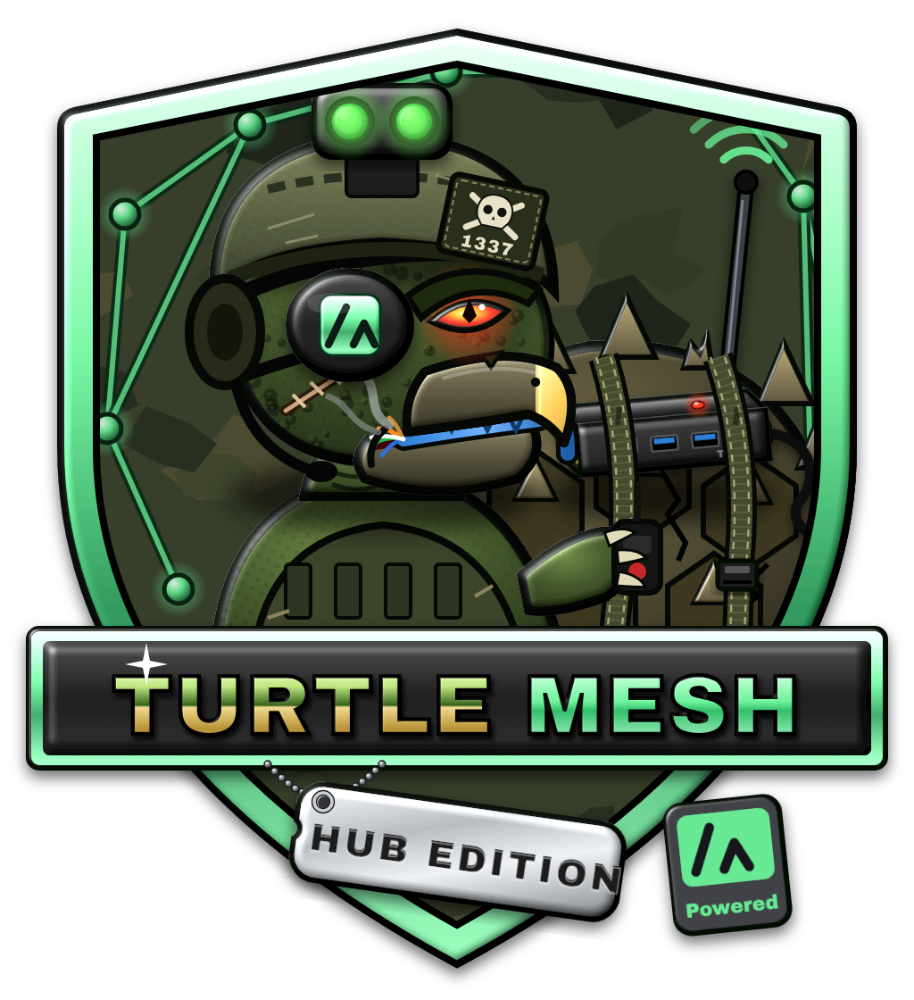

# TurtleMesh

Meshtastic payloads for the **Hak5 LAN Turtle** family. The LAN Turtle runs a Meshtastic radio, watches the mesh, sends alerts over LoRa, and can bridge the mesh to TAK.

| Edition | Device | Status |
|---|---|---|
| [**Hub Edition**](payloads/library/general/TurtleMesh-Hub/) | LAN Turtle Hub | 1.0.0 |

**Hub Edition** gives the Hub:

- A Meshtastic radio over Wi-Fi or USB, with mesh chat, a node list and an offline map
- Radio settings and channels, traceroute and position requests
- Mesh watch alerts: new nodes, watched nodes going quiet, low battery, detection sensors
- Alerts over LoRa, including TurtleTAK's while it runs
- Direct-message commands from any node
- An optional mesh ↔ TAK bridge, including Meshtastic ATAK plugin users
- A private MQTT proxy to your own broker
- A web console

See its [README](payloads/library/general/TurtleMesh-Hub/README.md).

Part of the SECT0101 projects, with TurtleTAK, PagerMesh and PagerTAK. The radio code comes from PagerMesh.

> Meshtastic® is a registered trademark of Meshtastic LLC. Community project, not affiliated with Meshtastic or supported by Hak5.

## License

GPL-3.0. See [LICENSE](LICENSE).

[Buy Me a Coffee](https://buymeacoffee.com/sect0101)
