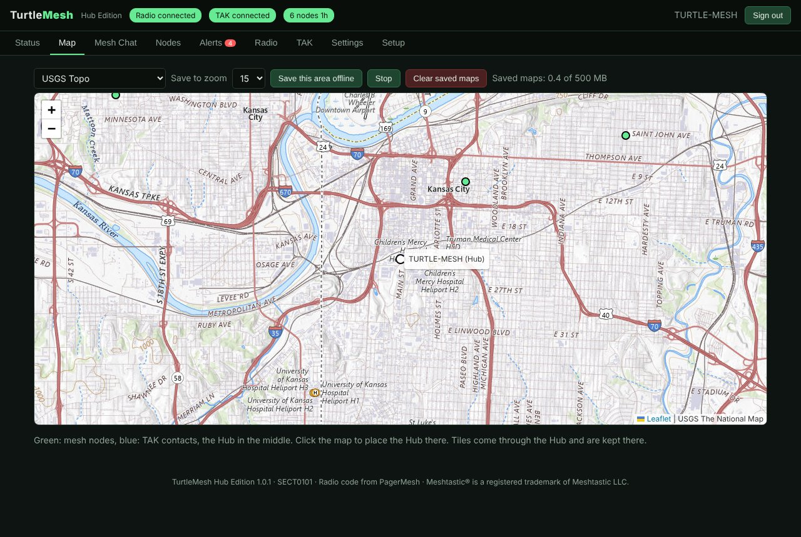
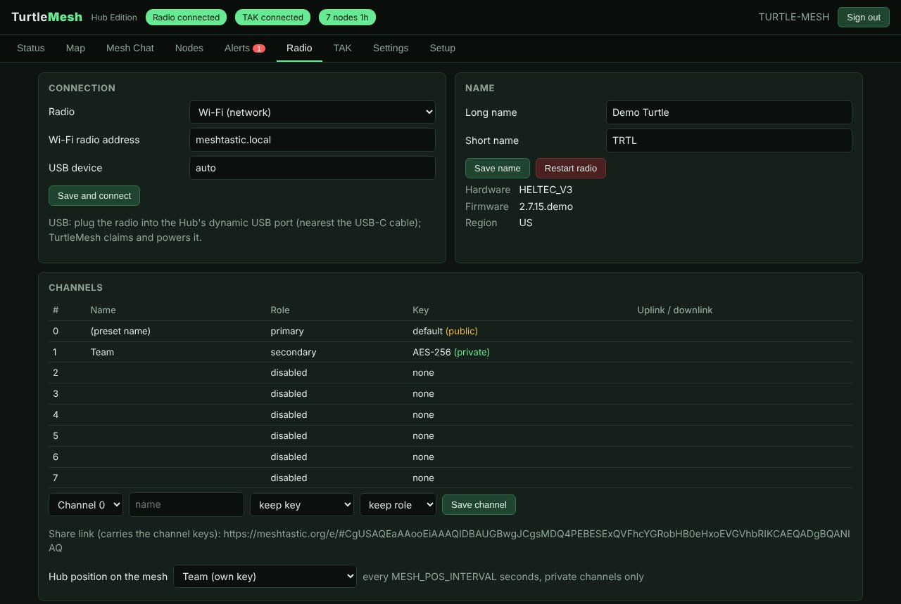

# TurtleMesh Hub Edition

Puts a **Meshtastic** radio on the **Hak5 LAN Turtle Hub**.

The Hub connects to a Meshtastic radio over Wi-Fi or USB and serves a web console for mesh chat, nodes, the map and radio settings. It watches the mesh and sends alerts over LoRa. With a TAK Server, it puts the mesh on the TAK map.

> Meshtastic® is a registered trademark of Meshtastic LLC. TurtleMesh is a community payload, not affiliated with Meshtastic and not supported by Hak5.

## Features

| Feature | What it does |
|---|---|
| **Radio** | Any Meshtastic radio over **Wi-Fi / Ethernet** (TCP 4403) or **USB serial** on the Hub's dynamic USB port. It reconnects on its own. |
| **Mesh chat** | Every channel, plus direct messages to any node, from the web console. Delivery status is shown for messages you send. |
| **Nodes** | Every node heard: name, hardware, role, battery, SNR, hops, last heard, and range and bearing from the Hub. Give nodes labels, **traceroute** them, or **request a position**. Download the packet log as CSV or pcap. |
| **Map** | Mesh nodes, TAK contacts and the Hub on the web map (Leaflet, built in). Tiles are cached on the Hub (USB storage when attached), and **Save this area offline** stores USGS maps for use without internet. |
| **Hub on the mesh** | Off until you pick a channel (Radio > *Hub position on the mesh*). Then the Hub's position goes out every `MESH_POS_INTERVAL` seconds (15 min), on a channel with its own key only. |
| **Radio settings** | Long and short name; channels (name, role, new random key, default key or no encryption) and the share link; LoRa, device, position, telemetry, network, Bluetooth, MQTT, display and power settings; restart. |
| **Mesh watch** | Learns which nodes belong for `MESH_LEARN_MIN` minutes (60), then raises **New mesh node** for any node not seen before. **Watch** a node to get **Node quiet** after `NODE_QUIET_MIN` minutes of silence (and **Node back**) and **Low battery** under `LOW_BATTERY` %. A quiet sensor node is critical. **Radio link lost / restored** too. |
| **Sensors** | Detection-sensor packets (a radio running Meshtastic's detection-sensor module, like a door contact or PIR) become alerts. Mark a node as a **Sensor** and its text messages become alerts too. |
| **Alerts over LoRa** | Off until you choose where they go (Alerts tab): a channel, or a DM to one node (`LORA_ALERT_TO`). A public channel works but gets a warning, since alerts can carry device names, IP and MAC addresses. Alerts look like `[TURTLE-MESH] WARNING Node quiet: Gate 2 - Not heard on the mesh for 61m`. While **TurtleTAK** runs on the same Hub, its alerts (new devices, ARP spoofing, link tamper) go out too. |
| **DM commands** | Any node can direct-message the Hub's radio: `status`, `alerts`, `where`, `nodes`, `help`. Answers are short enough for LoRa. `MESH_COMMANDS_FROM` limits who can ask. |
| **Mesh ↔ TAK** | Optional. Mesh nodes show on TAK as markers. One mesh channel and TAK All Chat Rooms carry each other's messages, once you pick a channel with its own key (a public channel can't be bridged). Meshtastic **ATAK plugin** users (TAK packets on the mesh) show on the TAK Server with their callsign, team and role. Alerts go to TAK as markers and chat lines. TAK users can DM the Hub the same commands. |
| **MQTT proxy** | The Hub carries the radio's MQTT traffic to your own broker (`MQTT_HOST`), so a USB radio without Wi-Fi can still use MQTT. *Set up the radio for it* turns on the radio's MQTT client proxy. |
| **Alert settings** | Each alert type on or off; the lowest level for TAK markers, TAK chat lines and LoRa; and quiet hours (for example `22-06`). |
| **Web console** | Status, Map, Mesh Chat, Nodes, Alerts, Radio, TAK, Settings and Setup on port **8485**, on every interface: USB-C host, RJ45, Wi-Fi and VPN. Password protected. |

## Screenshots

Web console, with demo data.

| Status | Map |
|---|---|
|  |  |
| **Mesh Chat** | **Nodes** |
|  |  |
| **Alerts** | **Radio** |
|  |  |
| **TAK** | **Setup** |
|  |  |

## Setup

1. Copy `payload.sh` to the Hub as its payload (web UI editor, `scp`, or USB) and run it.
2. The first run creates `/root/turtlemesh/`. It posts the web console's **first password** as a Hub notification and writes it to `/root/turtlemesh/web-password.txt`. Change it in Setup, then delete that file.
3. Open `http://172.16.84.1:8485` from the USB-C host, or the Hub's RJ45, Wi-Fi or VPN address, and sign in.
4. **Radio** tab:
   - **Wi-Fi radio**: turn on Wi-Fi in the radio (Meshtastic app > Settings > Network), put it on the same network as the Hub, and enter its IP address.
   - **USB radio**: plug it into the Hub's **dynamic USB port** (the one nearest the USB-C cable) with a data cable. TurtleMesh claims and powers the port. Radios with native USB (ESP32-S3 boards like the Heltec Wireless Tracker, and nRF52 boards) work with the Hub's built-in `cdc-acm` driver and show up as `/dev/ttyACM0`. Radios with a CP210x or CH34x USB chip (Heltec V3, T-Beam and others) need a driver the stock Hub firmware may not have; use Wi-Fi for those. If a USB radio doesn't connect, the Radio card says why.
5. Optional:
   - **TAK** (Setup tab). With **TurtleTAK** on the same Hub and `TAK_FROM_TURTLETAK: 1` (the default), TurtleMesh uses TurtleTAK's server and certificates. Otherwise, connect the same way as ATAK: a **connection package**, the **certificates** (client and truststore, each with its own password), or **enroll** with a TAK username and password. No openssl needed.
   - The Hub's **location** (Setup, or click the map), for range and bearing and for its position on the mesh.
   - **Alerts over LoRa** (Alerts tab) and the **MQTT proxy** (Settings, then TAK > *Set up the radio for it*).
6. *Run TurtleMesh at boot* is on by default.

The Hub runs one payload at a time. TurtleMesh reads TurtleTAK's server settings whenever TurtleTAK is installed, but relays TurtleTAK's alerts over LoRa only while TurtleTAK is running. To run both, use [TurtleShell](https://github.com/SECT0101/TurtleShell): one payload that runs TurtleTAK and TurtleMesh together, shares the radio's GPS fix with TurtleTAK, and leaves the LED to TurtleTAK.

Running the payload again restarts the service with that version. The service and web page in `/root/turtlemesh/app/` are rewritten on every run, and your settings, certificates, node labels and chat history are kept.

## Location

In **Auto**, TurtleMesh uses the first of these that has a usable position:

1. **Radio GPS**: the radio's own GPS fix (a Heltec Wireless Tracker, T-Beam, RAK with GPS...), while it's newer than `RADIO_GPS_MAX_AGE` (30 min). The radio then sends its own position on the mesh, so TurtleMesh doesn't send a second one.
2. **USB GPS** on the Hub's dynamic USB port (`GPS_DEVICE`).
3. **My phone (ATAK)**: your ATAK position from the TAK Server (`MY_ATAK` callsign).
4. **My phone (mesh)**: a mesh node you pick (`MY_NODE`), like the radio paired to your phone. The Meshtastic app shares the phone's GPS through it, with no TAK Server needed.
5. A **saved site**, then a **manual** lat/lon (Setup, or click the web map).
6. **Network**: public IP location, city level only. TAK shows a 25 km circle.

Phone positions count while they're newer than `ANCHOR_MAX_AGE` (30 min). Pick a **primary source** in Setup > Location to put it first; the rest stay as fallback in the same order.

## Mesh channels and privacy

Channel 0 on most meshes is public: it uses no key, the default key or a well-known "simple" key, so anyone with Meshtastic can read it. TurtleMesh sends nothing on any channel until you choose one:

- **Alerts over LoRa**: off until you choose a channel or a node (Alerts tab). A public channel is allowed, with a warning.
- **TAK chat bridge** and **Hub position**: only channels with their own key. Public channels are shown but can't be picked.
- The Radio tab marks each channel's key as *public* or *private*. Use *new random key* there to make a private channel, then share it with the share link.

Updating from 1.0.0 turns off the old channel 0 defaults once and posts a Hub notification, so you can pick channels.

## LED

| LED | Meaning |
|---|---|
| Magenta solid | Starting |
| Yellow double | Connecting to the radio |
| Green single | Radio connected (and TAK, if set up) |
| Cyan single | Radio connected, TAK not connected |
| Red slow | No radio set up |
| Cyan inverse (60 s) | Warning alert |
| Red fast (60 s) | Critical alert |

Set `LED: 0` to keep the LED dark.

## Settings

Every setting is in `/root/turtlemesh/default.cfg` as `KEY: value`. Change them in the web console's **Settings** tab or over SSH. The most used ones:

| Key | Default | |
|---|---|---|
| `RADIO_CONN` | `wifi` | `wifi` or `usb` |
| `RADIO_HOST` / `RADIO_PORT` | / `4403` | Wi-Fi radio address |
| `RADIO_DEV` | `auto` | USB serial device |
| `CALLSIGN` | `TURTLE-MESH` | Name on TAK and in alerts |
| `LOC_MODE` | `auto` | Primary location source: `auto`, `radio`, `gps`, `atak`, `mesh`, `site`, `manual` or `ip` |
| `MY_ATAK` / `MY_NODE` | | Your ATAK callsign / your mesh node (`!a1b2c3d4`) for the phone sources |
| `MESH_POS_CHANNEL` / `MESH_POS_INTERVAL` | `-1` / `900` | Channel for the Hub's position (`-1` = off; channels with their own key only) and seconds between positions |
| `MESH_LEARN_MIN` | `60` | Minutes of learning before *New mesh node* alerts |
| `NODE_QUIET_MIN` / `LOW_BATTERY` | `60` / `20` | Watched node limits |
| `LORA_ALERTS` / `LORA_ALERT_MIN` | `0` / `warning` | Alerts over LoRa and the lowest level sent |
| `LORA_ALERT_CHANNEL` / `LORA_ALERT_TO` | / | Channel for alerts (none until you choose), or a `!node` id for DMs |
| `LORA_ALERT_SOURCES` | `turtletak,turtlemesh` | Whose alerts go out over LoRa |
| `MESH_COMMANDS_FROM` | | Blank = any node, or a list of `!node` ids |
| `TAK` / `TAK_FROM_TURTLETAK` | `1` / `1` | TAK on, and use TurtleTAK's server and certificates |
| `BRIDGE_NODES` / `BRIDGE_ATAK_PLUGIN` | `1` / `1` | Mesh nodes and ATAK plugin users on TAK |
| `BRIDGE_CHAT_CHANNEL` | `-1` | Mesh channel bridged to TAK All Chat Rooms (`-1` = off; channels with their own key only) |
| `MQTT_PROXY` / `MQTT_HOST` / `MQTT_PORT` | `0` / / `1883` | MQTT proxy to your broker (`MQTT_TLS`, `MQTT_USER`, `MQTT_PASSWORD`) |
| `ALERTS_ON` | all types | Alert types that are raised |
| `QUIET_HOURS` | | For example `22-06` |
| `MAP_SOURCE` / `TILE_CACHE_MB` | `usgs_topo` / `500` | Web map and its tile cache limit |
| `WEB_PORT` | `8485` | Web console port (TurtleTAK uses 8484; never 1471, the Hub's own UI) |

### All settings

Every key in `default.cfg`, in the order the file lists them. The Settings tab shows the same list.

| Key | Default | |
|---|---|---|
| **Radio** | | |
| `RADIO_CONN` | `wifi` | `wifi` (radio on the network, TCP 4403) or `usb` (radio on the Hub's USB port) |
| `RADIO_HOST` | | Wi-Fi radio's IP address or hostname |
| `RADIO_PORT` | `4403` | Wi-Fi radio's TCP port |
| `RADIO_DEV` | `auto` | USB radio: `auto`, `/dev/ttyACM0` or `/dev/ttyUSB0` |
| `RADIO_CLAIM_USB` | `1` | Claim and power the Hub's dynamic USB port for a USB radio |
| `MESH_POS_INTERVAL` | `900` | Seconds between the Hub's position on the mesh (`0` = off) |
| `MESH_POS_CHANNEL` | `-1` | Channel for the Hub's position (`-1` = off; channels with their own key only) |
| **Mesh to TAK bridge** | | |
| `TAK` | `1` | Connect to a TAK Server |
| `TAK_FROM_TURTLETAK` | `1` | Use TurtleTAK's server and certificates when TurtleTAK is on this Hub |
| `TAK_HOST` | `takserver.example.com` | TAK Server name or IP |
| `TAK_PROTO` | `tls` | `tls` (client certificate), `tcp`, or `udp` (send only) |
| `TAK_PORT` | `8089` | Streaming port (TLS 8089, TCP 8087 or 8088) |
| `TAK_VERIFY_HOST` | `0` | `1` = also check the server's name against its certificate |
| `CLIENT_PASSWORD` | `atakatak` | Client certificate (`.p12`) password |
| `CA_PASSWORD` | `atakatak` | Truststore (`.p12`) password, can differ from the client one |
| `API_PORT` | `8443` | Server API port |
| `ENROLL_PORT` | `8446` | Certificate enrollment port |
| `CALLSIGN` | `TURTLE-MESH` | Name on TAK and in alerts |
| `UID` | | Made once from the Hub; leave blank |
| `TEAM` | `Cyan` | Team color sent with the Hub's marker |
| `ROLE` | `Team Member` | Role sent with the Hub's marker |
| `COT_TYPE` | `a-f-G-E-S` | The Hub's marker type on TAK |
| `SA_INTERVAL` | `60` | Seconds between the Hub's reports to TAK |
| `BRIDGE_NODES` | `1` | Mesh nodes with a position become TAK markers |
| `BRIDGE_NODE_MAX_AGE` | `7200` | Seconds: nodes not heard for longer are not sent |
| `BRIDGE_CHAT_CHANNEL` | `-1` | Mesh channel linked with TAK All Chat Rooms (`-1` = off; channels with their own key only) |
| `BRIDGE_ATAK_PLUGIN` | `1` | Meshtastic ATAK plugin traffic (position and chat) to TAK |
| **Location** | | |
| `LOC_MODE` | `auto` | Primary source: `auto`, `radio`, `gps`, `atak`, `mesh`, `site`, `manual` or `ip`; the rest stay as fallback |
| `SITE` | | Saved site in use |
| `MANUAL_LAT` / `MANUAL_LON` | | Manual position |
| `MY_ATAK` | | Your ATAK callsign (position from the TAK Server) |
| `MY_NODE` | | Your mesh node, for example the radio paired to your phone (`!a1b2c3d4`) |
| `ANCHOR_MAX_AGE` | `1800` | Seconds a phone position stays usable |
| `RADIO_GPS_MAX_AGE` | `1800` | Seconds the radio's GPS fix stays usable |
| `GPS_DEVICE` | `off` | USB GPS: `off`, `auto`, or a port such as `/dev/ttyACM0` |
| `GPS_BAUD` | `9600` | USB GPS speed |
| `GPS_CLAIM_USB` | `0` | Claim the dynamic USB port for a USB GPS |
| `IPGEO` | `1` | Allow the public IP location |
| `IPGEO_URL` | `https://ipinfo.io/json` | Where the public IP location comes from |
| **Mesh watch and sensors** | | |
| `MESH_LEARN_MIN` | `60` | Minutes of learning which nodes belong before *New mesh node* alerts |
| `NODE_QUIET_MIN` | `60` | A watched node not heard for this long raises *Node quiet* |
| `LOW_BATTERY` | `20` | Percent: watched and sensor nodes below this raise *Low battery* |
| `SENSOR_LEVEL` | `warning` | Level of detection-sensor alerts: `info`, `warning` or `critical` |
| `UPLINK_WATCH` | `1` | Alert when the TAK link is down longer than `UPLINK_GRACE` |
| `UPLINK_GRACE` | `120` | Seconds before *TAK link down* |
| `RADIO_WATCH` | `1` | Alert when the radio link is lost |
| **Alerts** | | |
| `ALERTS_ON` | all types | Alert types that are raised: `new_node`, `quiet`, `battery`, `sensor`, `radio`, `uplink`, `cert` |
| `ALERT_MARKER` | `1` | Alert markers on the map |
| `MARKER_MIN_LEVEL` | `warning` | Lowest level that gets a map marker: `info`, `warning` or `critical` |
| `ALERT_CHAT` | `1` | Alert lines in TAK chat |
| `CHAT_MIN_LEVEL` | `info` | Lowest level that gets a chat line |
| `ALERT_TO` | | Blank = All Chat Rooms, or one callsign |
| `ALERT_STALE_HOURS` | `12` | Hours an alert marker stays on the map |
| `QUIET_HOURS` | | For example `22-06`: no chat lines or LED flashes then (still logged and marked) |
| `QUIET_CRITICAL` | `1` | Critical alerts still go out in quiet hours |
| `CERT_WARN_DAYS` | `30` | Days of warning before the client certificate expires |
| `HUB_NOTIFY` | `1` | Hub notifications (bell icon) |
| `C2_NOTIFY` | `0` | Cloud C² notifications too |
| **Alerts over LoRa** | | |
| `LORA_ALERTS` | `0` | Send alerts as mesh text (works when the network is down) |
| `LORA_ALERT_SOURCES` | `turtletak,turtlemesh` | Whose alerts go out over LoRa |
| `LORA_ALERT_MIN` | `warning` | Lowest level sent over LoRa |
| `LORA_ALERT_CHANNEL` | | Channel for alerts (none until you choose; a public channel gets a warning) |
| `LORA_ALERT_TO` | | Blank = the channel, or a node id (`!a1b2c3d4`) for a direct message |
| **Mesh commands** | | |
| `MESH_COMMANDS` | `1` | Answer `status`, `alerts`, `where`, `nodes` and `help` sent to the Hub's radio |
| `MESH_COMMANDS_FROM` | | Blank = any node, or a comma list of `!node` ids |
| `CHAT_COMMANDS` | `1` | The same commands as TAK direct messages |
| `CHAT_COMMANDS_FROM` | | Blank = anyone on the server, or a comma list of callsigns |
| **MQTT proxy** | | |
| `MQTT_PROXY` | `0` | `1` = the Hub carries the radio's MQTT traffic to your broker |
| `MQTT_HOST` / `MQTT_PORT` | / `1883` | Your MQTT broker |
| `MQTT_TLS` | `0` | `1` = TLS to the broker |
| `MQTT_USER` / `MQTT_PASSWORD` | | Broker sign-in |
| **Map** | | |
| `MAP_SOURCE` | `usgs_topo` | `usgs_topo`, `usgs_imagery`, `usgs_hybrid` or `osm` (live only, never saved in bulk) |
| `TILE_CACHE_MB` | `500` | Map tile cache limit (on USB storage when one is attached) |
| `TILE_MAX_DOWNLOAD` | `20000` | Most tiles one *Save this area offline* may fetch |
| **Uplinks** | | |
| `WIFI_SSID` / `WIFI_KEY` | | Out-of-band Wi-Fi uplink (the Hub joins this network as a client) |
| `WIFI_ENC` | `psk2` | `open`, `psk`, `psk2` or `sae` |
| `WIFI_COUNTRY` | `US` | Wi-Fi country code |
| `WG_CONF` | | WireGuard config path (set by uploading `wg.conf`) |
| **Hub** | | |
| `LED` | `1` | `0` = keep the LED dark |
| `RUN_AT_BOOT` | `1` | Start TurtleMesh when the Hub boots |
| `SETTINGS_VERSION` | `2` | Set by TurtleMesh; leave as is |
| `WEB` | `1` | Web console on |
| `WEB_PORT` | `8485` | Web console port (TurtleTAK uses 8484; never 1471, the Hub's own UI) |
| `WEB_BIND` | `0.0.0.0` | Every interface: USB-C host, RJ45, Wi-Fi and VPN |
| `WEB_TLS` | `0` | `1` = HTTPS with a self-signed certificate (needs `openssl`) |
| `WEB_PASS_HASH` | | Web console password, set with *Change password* |

## Files

| Path | |
|---|---|
| `/root/turtlemesh/default.cfg` | Settings |
| `/root/turtlemesh/certs/` | TAK certificates and connection packages. Never share them. |
| `/root/turtlemesh/nodes.json` | Node labels, watch and sensor flags |
| `/root/turtlemesh/known_nodes.json` | Nodes that belong to the mesh |
| `/root/turtlemesh/mesh_chat.jsonl` | Mesh chat history |
| `/root/turtlemesh/tiles/` | Saved map tiles (`/usb/turtlemesh-tiles/` when USB storage is attached) |
| `/root/turtlemesh/logs/` | `turtlemesh.log` (also in the web console) and `console.log` |
| `/root/turtlemesh/app/` | The service and web page, rewritten on every run |

## Credits

The radio code (Meshtastic protocol, radio settings, packet log) comes from [PagerMesh](https://github.com/SECT0101/PagerMesh). The web map uses [Leaflet](https://leafletjs.com) (BSD-2-Clause), bundled in the payload. USGS map tiles are from The National Map.

## Requirements

- LAN Turtle Hub with Python 3. The Hub runs Bash and Python payloads.
- A Meshtastic radio with Wi-Fi or USB serial (built for a Heltec V3 over Wi-Fi).
- For TAK: a network path to your TAK Server. `openssl` is **not** needed.
